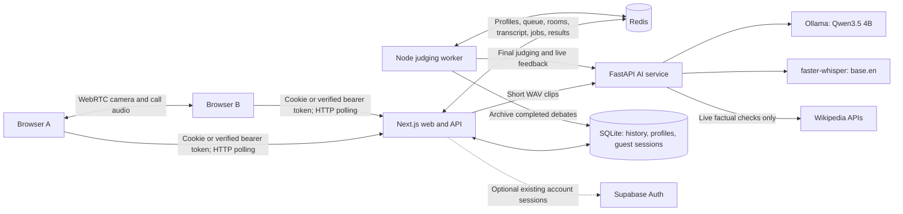

# Ranked Debate

A local-first prototype that pairs people for a live, one-to-one video debate, saves each speaker’s contributions, and produces a shared AI judgment. Live coaching and limited source-backed factual checks appear during the conversation.

**Status:** guest profiles, concurrent matchmaking, video signalling, English transcription, saved submissions, recoverable judging jobs, and provisional live feedback are implemented. The judge uses a pretrained model; this repository does **not** yet contain a debate-fine-tuned model or a validated production accuracy claim. Durable local history and Supabase account sign-in/import are implemented. Applied Elo updates, TURN infrastructure, and public deployment hardening remain planned. See [the project plan](docs/PROJECT_PLAN.md) and [model training and evaluation](docs/MODEL_TRAINING.md).

## End-to-end behavior

1. Open the dashboard, enter a display name, and click **Save**. The header shows **Saved as** after Redis acknowledges it. Refreshing preserves the name for that identity.
2. Choose topics and enter the queue. The server atomically pairs eligible waiting users who share a topic; a user cannot occupy two newly allocated rooms.
3. Participants exchange WebRTC offers, answers, and ICE candidates through authenticated HTTP routes. Camera and call audio travel peer to peer.
4. Click **Start Live Transcript** to capture your own microphone, or send text contributions. Both participants see speaker-labelled text saved by the backend.
5. A worker periodically reads recent saved contributions, produces provisional rubric feedback, identifies claims/rebuttals, and checks factual claims against retrieved Wikipedia summaries. Missing or insufficient evidence stays **Unverified**.
6. **Submit Debate** flushes pending contributions. The server freezes that participant’s saved transcript; their first submission cannot be replaced. Both submissions enqueue final judging.
7. The worker asks the local model for rubric scores, validates the response, calculates the winner deterministically, and saves one shared result. Failed jobs retry and survive web/worker restarts while Redis retains data.

## History and accounts

Completed debates are archived to an ignored local SQLite database. Open `/history` to review your saved transcript, rubric scores, and checked sources. `/account` supports Supabase email/password sign-up/sign-in and explicit import of the current browser guest’s history. Imported records preserve the original speakers. Signing out removes access to account history.

Accounts require an active Supabase Auth project. This phase uses Supabase for authentication and SQLite for history; it does not require a Supabase database secret. Follow [the Step 5 setup, identity rules, backups, and test guide](docs/HISTORY_AND_ACCOUNTS.md).

## Architecture



The browser does not connect directly to Ollama or Redis. The Python service has no Redis dependency; Next.js and the worker own persistence and authorization. Keep Python/Ollama private to the backend network. Supabase supplies optional account authentication. Redis coordinates live rooms; SQLite stores durable local history.

## Technology

| Layer | Implementation |
| --- | --- |
| Web framework | Next.js 16.4.3 App Router; React and React DOM 19.2.4 |
| Language and styling | TypeScript 5, Tailwind CSS 4, PostCSS; system fonts |
| Build and validation | webpack, ESLint 9 with Next.js rules, TypeScript checking |
| Node runtime | Node.js 22.18+; native TypeScript imports in the worker; CI uses Node 24 |
| Live database and queues | Redis; atomic Lua scripts, lists, hashes, sorted sets, expiring leases |
| Durable history | Node built-in SQLite, WAL transactions, participant ownership, online backups |
| Redis clients | ioredis for TCP Redis; @upstash/redis through a shared command adapter or hosted REST |
| Sessions | HTTP-only guest cookie with durable hashed credentials; verified Supabase account bearer sessions |
| Realtime media | Browser WebRTC, getUserMedia, Google STUN; HTTP signalling/polling |
| Browser speech pipeline | Web Audio/AudioWorklet, mono 16 kHz PCM WAV, IndexedDB upload outbox, localStorage drafts |
| AI API | Python, FastAPI, Uvicorn, Pydantic 2, HTTPX |
| Judge inference | Ollama; default pretrained `qwen3.5:4b`; JSON-schema-constrained responses |
| Speech recognition | faster-whisper `base.en`; CTranslate2 CPU/int8; Silero VAD through runtime dependencies |
| Evidence retrieval | Wikipedia search and summary APIs; standard curl or HTTPX transport; bounded cached extracts |
| Testing | Node built-in runner against Redis/SQLite; pytest; opt-in real-model CLI and Playwright integration |
| Automation | GitHub Actions: application tests, Python tests, lint, production build |

JavaScript resolutions are in `package-lock.json`; Python dependencies currently use version ranges in `ai-service/requirements.txt`, so Python installs are not fully locked. No paid model API key is required for the active local AI path. `lib/openai.ts` is legacy code and is not the active judge.

## Local setup

### Prerequisites

- Node.js 22.18 or newer and npm.
- Python with venv support. CI targets Python 3.12; development has also run on Python 3.14. Native speech dependency wheels depend on your OS/Python version.
- Redis reachable by the web process and worker, or Upstash Redis REST credentials.
- Ollama installed and sufficient memory/disk for the model. Actual latency depends on hardware; no public-capacity benchmark has been established.
- A current browser with camera/microphone permission. Media capture requires localhost or HTTPS.

### 1. Install the web app

```bash
git clone https://github.com/Srangi2025/debate-app.git
cd debate-app
npm ci
cp .env.example .env.local
```

The example selects `REDIS_URL=redis://127.0.0.1:6379` and `AI_JUDGE_URL=http://127.0.0.1:8001`. Edit `.env.local` for your environment. Do not commit credentials.

### 2. Start Redis

If you already have a local Redis service, use it. Otherwise, with Redis installed, a development-only foreground server can be started in another terminal:

```bash
redis-server --bind 127.0.0.1 --port 6379
```

For hosted Upstash, remove `REDIS_URL` and set both REST credentials. `REDIS_URL` takes precedence. All app instances and workers must point to the same database. Configure persistence and backups separately for durable data.

### 3. Start Ollama and download the judge

```bash
ollama serve
```

If the Ollama desktop application already manages the server, do not start a second one. In another terminal:

```bash
ollama pull qwen3.5:4b
ollama list
```

Model weights live in Ollama’s own storage and are not committed to Git.

### 4. Install and run Python

From the repository root:

```bash
cd ai-service
python3 -m venv .venv
.venv/bin/python -m pip install -r requirements.txt
cp .env.example .env
# Optional warm-up: download speech weights before the first spoken debate.
.venv/bin/python -c 'from app.transcription import speech_model; speech_model()'
.venv/bin/python -m uvicorn app.main:app --env-file .env --host 127.0.0.1 --port 8001
```

Run these commands in `ai-service`, so Python can import `app`. On Windows, use the venv’s `Scripts` paths. Speech weights are cached under ignored `ai-service/.models/` by default. The warm-up command uses shell environment/defaults; export `WHISPER_MODEL` and `WHISPER_MODEL_DIR` first if using custom values.

### 5. Start the app and worker

In another terminal, from the repository root:

```bash
npm run dev
```

This launches Next.js **and** the Node judging worker. Open [http://localhost:3000](http://localhost:3000). Redis, Python, and Ollama remain separate processes. `npm run dev:web` starts only the web process.

### 6. Check the installation

```bash
curl http://127.0.0.1:8001/health
curl http://127.0.0.1:8001/transcription/health
curl http://127.0.0.1:11434/api/tags
```

`/health` identifies the configured judge but does not run inference. Speech health reports `ready: false` until the speech model loads; that is expected before warm-up/first capture. Use the benchmark below to exercise actual model inference.

Open one regular browser window and one incognito/guest window at the **same hostname**, save different names, choose a common topic, and join. Regular tabs share a guest identity and cannot match each other. `localhost` and `127.0.0.1` have different cookies; use one consistently.

## Configuration

### Root `.env.local`: web and Node worker

Next.js and the worker load Next.js environment files from the repository root. Production should normally inject environment variables through its process manager.

| Variable | Purpose |
| --- | --- |
| `REDIS_URL` | TCP/TLS Redis connection; takes precedence over Upstash REST |
| `UPSTASH_REDIS_REST_URL` | Hosted Redis REST endpoint when `REDIS_URL` is absent |
| `UPSTASH_REDIS_REST_TOKEN` | Hosted Redis REST credential; server only |
| `AI_JUDGE_URL` | Backend Python origin; required for final/live AI processing |
| `HISTORY_DB_PATH` | Persistent local SQLite file shared by web and worker; defaults to `data/debate-history.sqlite` |
| `TRANSCRIPTION_URL` | Optional speech service origin; defaults to `AI_JUDGE_URL` |
| `NEXT_PUBLIC_SUPABASE_URL` | Active Supabase Auth project URL for permanent accounts |
| `NEXT_PUBLIC_SUPABASE_PUBLISHABLE_KEY` | Optional public Supabase auth key; never use a service-role secret here |
| `REDIS_TEST_URL` | Test-only Redis connection; defaults to localhost:6379 |

### `ai-service/.env`: Python

Uvicorn loads this file only when launched with `--env-file .env`. Python evaluation/warm-up commands use shell environment unless explicitly loaded; root `.env.local` is not automatically read by Python.

| Variable | Default / purpose |
| --- | --- |
| `OLLAMA_URL` | `http://127.0.0.1:11434`; inference server |
| `JUDGE_MODEL` | `qwen3.5:4b`; must already be installed in Ollama |
| `JUDGE_CONTEXT_TOKENS` | `16384`; final-judge per-call budget, configurable from 8192 to 65536; larger values require more model memory |
| `WHISPER_MODEL` | `base.en`; English speech model |
| `WHISPER_MODEL_DIR` | `ai-service/.models`; speech cache |
| `FACT_CHECK_USER_AGENT` | Descriptive prototype identifier; set a real application contact for deployment |
| `EVIDENCE_TRANSPORT` | `curl` when installed, otherwise `httpx`; can explicitly select either |

The selected evidence transport is not rotated after access failures. Failed retrieval produces unverified claims.

## Matching and room lifecycle

Each join/status request runs an atomic Redis operation. It finds the oldest eligible participant sharing a selected topic. Queue heartbeats preserve the original arrival time; equal timestamps use user ID as a stable tiebreaker. Candidate scanning continues past incompatible/expired pages, and paired users are removed from all topic indexes.

The allowed rating gap widens from 100 to 200 after 10 seconds, 400 after 20 seconds, and any rating after 30 seconds. Both participants’ windows must allow the pair. Ratings currently default to 1500; permanent ranking updates are not connected.

For compatible users: 3 produce one pair and one waiting user; 4 produce two pairs; 10 produce five pairs. An even user count alone does not guarantee pairing when topics/rating eligibility differ. Existing rooms are never rearranged. Queue and room presence expire after approximately two minutes without check-ins; cleanup occurs through subsequent requests. **Leave Match** closes the room; **Next Opponent** closes it and rejoins.

## Speech, saving, and judging

Speech capture is opt-in. The browser sends clips after a short pause or about eight seconds. The backend accepts bounded mono 16 kHz PCM16 WAV uploads, up to 15 seconds/1 MB, and persists the recognized text rather than raw audio. Each speaker has a 20,000-character/500-segment limit; a single text segment is capped at 2,000 characters. Headphones reduce the chance of the opponent’s audio being picked up by your microphone.

Pending contributions use an IndexedDB outbox with stable IDs and retry after refresh. Text drafts use localStorage. Successfully acknowledged audio is removed from browser storage. If storage is unavailable, keep the page open until saving completes. An unfinished clip can be lost if the page closes before the clip is created.

The first final submission is immutable. The server assembles it from that participant’s saved contributions rather than trusting a browser-edited summary. After both submit, a saved job runs independently of the result page. Jobs have a four-minute ownership lease, renewed by the owning worker every minute during inference, and up to five attempts with exponential delays; exhausted jobs expose **Retry AI Judging**. Token-checked finalization prevents stale workers from overwriting a result. One worker processes one job at a time; additional workers can share Redis.

### Rubric

| Criterion | Weight |
| --- | --- |
| Reasoning | 30% |
| Evidence | 25% |
| Rebuttals | 25% |
| Relevance | 20% |

The model returns integer scores from 0 to 10 and grounded explanations. The server computes weighted totals; a difference of at most 0.25 is a tie. Model output must satisfy the schema. Temperature zero reduces sampling variability but does not prove impartiality or correctness.

Final judging now reviews every transcript section and performs fresh source checks on up to two selected factual claims per side. The final scoring prompt receives those checked verdicts and actual source quotations. Short submissions fit verbatim; long debates use bounded, recursively compressed section reviews. Results show which path was used, the source cards, and checked claim IDs considered in scoring. Summaries can lose nuance, and most claims can remain unchecked. See [final judging details](docs/FINAL_JUDGING.md). Elo is available as a preview endpoint only; applied rating updates remain disabled.

### Live feedback and sources

The first update is scheduled approximately four seconds after a saved contribution. Subsequent updates are spaced at least 25 seconds after the previous analysis finishes; inference adds latency. Final jobs have priority between jobs, not preemption of an inference already running. Live jobs have 90-second leases and recover after interruption.

Live analysis uses up to 40 recent segments/8,000 characters, identifies up to three claims per update, and retains a bounded claim history. Factual checks retrieve up to three English Wikipedia summary extracts per claim. A `supported`, `contradicted`, or `mixed` label requires a quotation that actually appears in a fetched extract. Invalid citations, unavailable sources, or insufficient evidence become `unverified`. Opinions/predictions become `not_checkable`.

Quote validation proves that text was retrieved; it does not prove that the quote logically establishes the full claim. These labels remain provisional. Coverage is limited to Wikipedia summaries, not a broad primary-source fact-checking service. See the [MediaWiki API documentation](https://www.mediawiki.org/wiki/API:REST_API/Reference) and [Page Content Service](https://www.mediawiki.org/wiki/Page_Content_Service).

## Storage and authorization

Redis stores live coordination data and pending archive delivery. SQLite stores immutable completed debates, participant ownership, profiles, and hashed guest sessions. See [the Step 5 schema and backup guide](docs/HISTORY_AND_ACCOUNTS.md).

| Key family | Data |
| --- | --- |
| `guest-session:<credential>` | Guest identity; 30-day session lifetime |
| `users:usernames`, `users:ratings` | Display names and existing rating values |
| `user:<uid>:queue`, `queue:topic:<topic>` | Queue membership, topics, arrival/presence, sorted topic indexes |
| `user:<uid>:match`, `match:<id>` | Current room pointer, participants, captured names, status/presence |
| `signal:<id>:...` | WebRTC offers/answers/candidates; short TTL |
| `match:<id>:transcript*` | Saved speaker text, contribution deduplication, size accounting |
| `match:<id>:submissions` | Frozen final submissions |
| `judging:jobs`, `judging:job:<id>`, `match:<id>:judging-lock` | Final job schedule, attempts, ownership leases |
| `judging:worker-heartbeat` | Worker availability hint |
| `feedback:jobs`, `match:<id>:feedback-*`, `match:<id>:live-feedback` | Live analysis schedule/state/leases and latest snapshot |
| `result:<id>` | Pending or completed shared outcome |
| `history:pending` | Retryable SQL archive delivery after finalization |
| `identity:<guest>:retired` | Guest-import reservation/retirement guard against in-flight queue joins |

Guests receive a random HTTP-only, SameSite=Lax cookie; HTTPS deployments use a secure cookie. Separate browser contexts have separate identities. Existing Supabase bearer tokens are verified server-side. Match-specific routes check participant membership; the server assigns speaker identity. Guest identity lasts until credential/cookie expiry; import it into an account for access beyond that browser session. SQLite and Redis persistence/backups must be configured for deployment. Retention/deletion tooling remains future work.

## API surface

### Next.js routes

| Method | Route | Purpose |
| --- | --- | --- |
| POST | `/api/session` | Establish/recover guest identity |
| GET / POST | `/api/profile` | Read/save display name |
| POST | `/api/queue/join` | Join selected topics and attempt pairing |
| GET | `/api/queue/status` | Refresh queue presence and matching status |
| POST | `/api/queue/leave` | Cancel queue membership |
| GET | `/api/match/[id]` | Read authorized room and update participant presence |
| POST | `/api/match/leave` | Close current room |
| GET / POST | `/api/match/[id]/transcript` | Read contributions; save text or transcribe WAV |
| GET | `/api/match/[id]/feedback` | Read saved live snapshot and processing state |
| POST | `/api/match/end` | Freeze own submission; enqueue when both submit |
| POST | `/api/match/judge` | Explicitly request/retry eligible final judging |
| GET | `/api/result/[id]` | Read participant-only result and job state |
| POST | `/api/webrtc/offer`, `/answer`, `/candidate`, `/reset` | Exchange room signalling (all under `/api/webrtc`) |
| GET | `/api/webrtc/poll` | Receive peer signalling |
| GET | `/api/leaderboard` | Read existing ratings; no automatic rating updates |
| GET | `/api/history`, `/api/history/[id]` | Read only the authenticated owner’s SQL history/transcript/results |
| GET | `/api/account` | Account/guest-import and active-room status |
| POST | `/api/account/claim` | Verified account plus guest-cookie proof to import history |

Legacy `/api/matchmake` and `/api/debug/reset` are disabled with HTTP 410. Main pages are `/`, `/dashboard`, `/queue`, `/match/[id]`, `/result/[id]`, `/leaderboard`, `/history`, `/history/[id]`, and `/account`.

### Private Python routes

| Method | Route | Purpose |
| --- | --- | --- |
| GET | `/health` | Configured judge identity/version |
| GET | `/transcription/health` | Speech model/loading state |
| POST | `/transcribe` | Multipart `audio` WAV to English text |
| POST | `/judge` | Topic plus `argument_a` / `argument_b` to rubric result |
| POST | `/live-feedback` | Saved segments to provisional coaching and checks |
| POST | `/elo/preview` | Project rating changes without applying them |

FastAPI’s local `/docs` exposes request/response schemas. This service has no standalone public authentication and must not be exposed directly to untrusted clients.

## Tests and model evaluation

From the repository root, with test Redis running:

```bash
npm test
npm run lint
npm run build
```

Individual suites: `test:matches`, `test:matchmaking`, `test:judging`, `test:transcript`, and `test:live`. Tests use isolated records and remove them; use a dedicated test Redis database rather than production.

From `ai-service`:

```bash
.venv/bin/python -m pytest tests -q
# Requires local Ollama/model; does not need live Wikipedia access.
.venv/bin/python -m evaluation.run evaluate \
  --facts evaluation/smoke-facts.jsonl \
  --offline-evidence \
  --output artifacts/baseline.json
```

Automated application/Python tests check implementation behavior, not model accuracy. The opt-in benchmark performs actual inference for judging, swapped speakers, and frozen-source factual checks. `--offline-evidence` disables final-judge network retrieval for reproducible offline runs; omit it to exercise fresh final retrieval as well. Synthetic smoke fixtures are explicitly labelled and rejected as human training data. Evaluation reports and private datasets are ignored by Git. Read [the model workflow](docs/MODEL_TRAINING.md) for human labels, leakage-resistant splits, supervised export, fine-tuning, and release criteria.

GitHub Actions runs lint, application tests with Redis, Python tests, and the build. It does not download judge weights, train a model, or certify accuracy.

## Production deployment

Build and run the web process:

```bash
npm ci
npm run build
npm start
```

Run the worker as a separate managed process from the same repository:

```bash
NODE_ENV=production npm run judge:worker
```

Also manage Python/Uvicorn, Ollama, and Redis independently. Web instances and workers must share the same Redis and AI origins. Keep secrets server-side, configure Redis persistence/backups and retention, use HTTPS for browsers, and keep internal AI endpoints private. A production supervisor should restart failed services and allow in-flight work to finish during shutdown.

The current SQLite archive requires persistent local storage shared by the web and worker processes on one host. Use a managed Node host/volume for this implementation. A shared SQL adapter is required before running these processes across separate hosts or Vercel serverless instances.

`vercel.json` configures the Next.js build only. Deploying that directory to Vercel does not provide the Python service, Ollama weights/hardware, Redis, or a persistent Node worker. GitHub stores source; pushing to GitHub does not by itself provision these services. This application cannot work as a static GitHub Pages export.

WebRTC currently uses Google STUN and has **no TURN relay**. Local testing does not establish connectivity across restrictive real-world networks. Add TURN, validate AI throughput/queue delay, and implement production account/history controls before a broad launch. Queue tests with 10 or 101 synthetic users establish pairing behavior, not equivalent AI/video capacity.

## Troubleshooting

| Symptom | Checks |
| --- | --- |
| Two windows never pair | Use regular + incognito/guest contexts, same hostname, a shared topic, and the same Redis backend; ensure Save succeeds |
| Name does not survive refresh | Check SQLite path/permissions, cookie acceptance, hostname consistency, and `/api/profile` response |
| Camera/mic unavailable | Allow permissions; use localhost or HTTPS; review browser device ownership |
| Video connects locally but not remotely | Restrictive networks may require the not-yet-configured TURN relay |
| Transcript unavailable | Check Python, model warm-up, `/transcription/health`, mic permissions, and pending outbox; text contributions remain available |
| Result stays pending | Check the Node worker, Python `/health`, Ollama `/api/tags`, and shared Redis; exhausted jobs expose retry |
| AI is slow | Weights may be loading; speech and model inference consume local resources; one worker processes one job at a time |
| Facts show Unverified | Sources may be unavailable, unrelated, or insufficient; inspect the linked quotations rather than assuming false |
| Port already in use | Reuse the existing service or stop the process you started; do not launch duplicate Ollama/Next processes |
| Python cannot import `app` | Run Uvicorn/tests/evaluation from `ai-service` |
| Account sign-in unavailable | Check the active replacement Supabase URL/publishable key, email auth settings, allowed redirects, and restart Next.js |
| History missing immediately after judging | Keep the worker running and check the retryable archive job/database path; use backfill for older completed rooms |
| Native dependency install fails | Use a Python version with compatible wheels, such as the CI target 3.12, and recreate the venv |

For LAN development, review `next.config.ts` allowed origins and browser secure-context requirements; another device’s `localhost` points to that device, not your development Mac.

## Repository layout

```text
app/                    Pages, browser components, and authenticated Next.js API routes
lib/                    Auth, Redis adapter, Lua workflows, transcript/outbox and worker logic
public/audio/           Browser AudioWorklet capture code
scripts/                Dev/worker launchers, history administration, and browser verification
ai-service/app/         FastAPI, model prompts, speech, live evidence checks, Elo preview
ai-service/tests/       Python behavior and dataset/evaluation tests
ai-service/evaluation/  Synthetic fixtures, dataset validation/export, real-model evaluation CLI
tests/                  Redis/SQLite Node integration tests
db/                     SQLite history schema
docs/                   Project plan and model training/evaluation documentation
.github/workflows/      CI validation
```

Local `.env*` files, virtual environments, weights, training data, generated artifacts, and backup copies are ignored. Environment examples are safe templates. The repository does not currently include a project license; third-party packages/models retain their own licenses.
